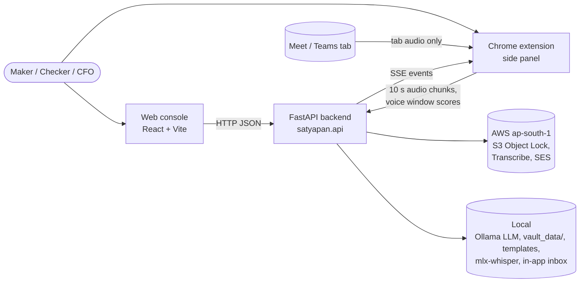
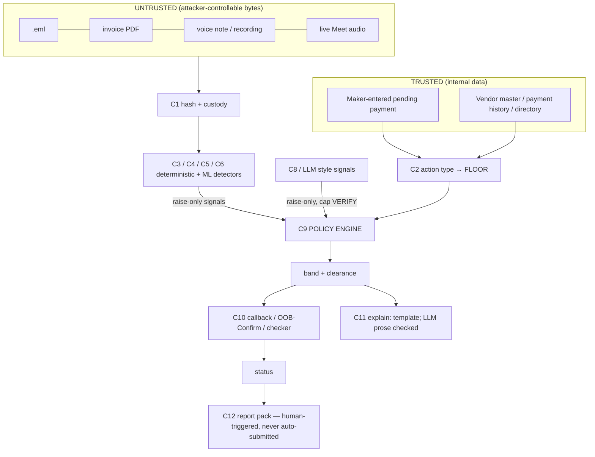

# Satyapan — Architecture (v3)

Source of truth for the design: the v3 approach. This file is the build-facing version.
Every number and rule here is implemented in code and checked by tests unless marked *(to do)*.

---

## 1. System context

**User (one choice):** the accounts-payable (AP) team of an Indian SME / mid-size company
(50-1,000 employees). The **maker** (Priya, AP executive) pays vendors by NEFT/RTGS/UPI. The
**checker** (Arjun, finance manager) approves. **Rajesh** is the CFO (claimed requester in the
demo). **Meera** is the security lead.

**Surface (one choice):**
1. **Payment Verification Desk** — web console (React) over a FastAPI backend.
2. **Chrome extension side panel** — listens to the *remote* party's audio in a Google Meet /
   Teams tab, scores it for synthetic voice on-device, shows live "ask" chips, offers
   one-tap OOB-Confirm.

**Out of scope (say it to judges):** phone calls and native WhatsApp apps (OS-level only, as
Google does on Pixel). Recordings come in through upload. Video/image detectors are not in the
MVP (DF26: best detector 69.7% AUROC, 34.5% on commercial generators).



## 2. Thesis in one paragraph

Every decision is attached to a **specific pending payment**. The minimum scrutiny (the
**floor**) is set deterministically by comparing that payment with the company's own vendor
master. Communications evidence can only **escalate**. Escalation changes *who* verifies, *through
which channel*, and *what gets frozen*. A deepfake works by manipulating the person who would do
the callback, so a detector hit moves verification away from that person (VERIFY → HOLD).

## 3. Components and module map

| # | Component | Type | Responsibility |
|---|---|---|---|
| C1 | Intake + Evidence Vault | deterministic | SHA-256 before parsing; blob store; hash-chained custody log; S3 Object Lock anchor |
| C2 | Transaction & Master | deterministic, TRUSTED | pending payment, vendor master, history, directory |
| C3 | Email checker | deterministic | Authentication-Results (trusted MTA only), From/Reply-To/Return-Path, look-alikes, `.bank.in`, free-mail |
| C4 | Document checker | deterministic | pdfplumber text, IFSC/account/UPI/GSTIN/amount regex, master diff, PDF edit metadata |
| C5 | Ask extractor | deterministic | lexicon + regex for asks A1-A7 in English, romanised Hinglish, Devanagari |
| C6 | Voice detector | ML | 5 s windows @16 kHz, XLS-R-L7 ONNX (on-device in the extension; Python for uploads) |
| C7 | Transcriber | ML | live: mlx-whisper on the M4; uploads: Transcribe hi-IN/en-IN, fallback whisper |
| C8 | Style classifier | ML, optional | raise-only, capped at VERIFY (not in MVP) |
| C9 | **Policy engine** | deterministic | floor table + escalation lattice + clearance. **The only component that sets the band** |
| C10 | Verification workflows | deterministic + human | callback logging, OOB-Confirm, checker HOLD flow, status changes, override, watchlist |
| C11 | Explainer | template + optional LLM | EN/HI templates (authoritative); local Ollama summary behind the faithfulness checker |
| C12 | Report pack | template | 1930 script, bank email, NCRP draft, evidence index, Sec 63 helper. Human-triggered |
| C13 | Chrome extension | browser | tabCapture → offscreen → ONNX + chunk upload; side panel UI |

**Module map** (checked by `tests/harness/test_docs_consistency.py`):

| Path | Component | Task(s) | Status |
|---|---|---|---|
| `src/satyapan/contracts/` | shared contracts | T01 | done |
| `src/satyapan/master/store.py` | C2 | T01 | done |
| `src/satyapan/policy/floor.py` | C9 floor | T02 | done |
| `src/satyapan/policy/targets.py` | C9 signal → band | T02 | done |
| `src/satyapan/policy/engine.py` | C9 decide / escalate | T02 | done |
| `src/satyapan/policy/clearance.py` | C9 clearance | T02 | done |
| `src/satyapan/policy/permissions.py` | C9/C10 roles | T02 | done |
| `src/satyapan/vault/hashing.py` | C1 | T09 core | done |
| `src/satyapan/vault/custody.py` | C1 | T09 core | done |
| `src/satyapan/vault/storage.py` | C1 | T09 | todo |
| `src/satyapan/vault/intake.py` | C1 | T09 | todo |
| `src/satyapan/vault/anchor.py` | C1 | T09 | todo |
| `src/satyapan/adapters/base.py` | interfaces + fakes | T01 | done |
| `src/satyapan/adapters/s3_store.py` | AWS S3 | T09 | todo |
| `src/satyapan/adapters/ses_mailer.py` | AWS SES | T12 | todo |
| `src/satyapan/adapters/ollama_llm.py` | local LLM (Ollama) | T15 | todo |
| `src/satyapan/adapters/transcribe_aws.py` | AWS Transcribe | T17 | todo |
| `src/satyapan/adapters/transcribe_whisper.py` | C7 local | T11 | todo |
| `src/satyapan/adapters/transcribe_local.py` | C7 local speech engine: mlx-whisper (Apple Silicon) or faster-whisper (any OS), warm-up, hallucination guard | finale | done |
| `src/satyapan/email/parser.py` | C3 | T03 | todo |
| `src/satyapan/email/domains.py` | C3 | T04 | todo |
| `src/satyapan/email/signals.py` | C3 | T04 | todo |
| `src/satyapan/document/extract.py` | C4 | T08 | todo |
| `src/satyapan/document/pdf.py` | C4 | T08 | todo |
| `src/satyapan/document/checker.py` | C4 | T08 | todo |
| `src/satyapan/asks/lexicon.py` | C5 | T05 | todo |
| `src/satyapan/asks/extractor.py` | C5 | T05 | todo |
| `src/satyapan/asks/phrasebook.py` | C5 live phrasebook (product-only patterns on top of the frozen lexicon) + informational cues (ADR-024) | finale | done |
| `src/satyapan/voice/rules.py` | C6 rules | T07/T11/T17 shared | done |
| `src/satyapan/voice/audio_io.py` | C6 | T17 | todo |
| `src/satyapan/voice/detector.py` | C6 | T17 | todo |
| `src/satyapan/voice/upload.py` | C6 + C7 | T17 | todo |
| `src/satyapan/live/service.py` | C7 live | T11 | todo |
| `src/satyapan/explain/prompt.py` | C11 safety core | T15 core | done |
| `src/satyapan/explain/templates.py` | C11 | T14 | todo |
| `src/satyapan/explain/faithfulness.py` | C11 | T15 | todo |
| `src/satyapan/explain/summary.py` | C11 | T15 | todo |
| `src/satyapan/workflows/oob.py` | C10 | T12 | todo |
| `src/satyapan/workflows/callbacks.py` | C10 | T13 | todo |
| `src/satyapan/workflows/status.py` | C10 | T13 | todo |
| `src/satyapan/workflows/watchlist.py` | C10 (R4) | T13 | todo |
| `src/satyapan/report/pack.py` | C12 | T16 | todo |
| `src/satyapan/report/pack_v2.py` | C12 golden-hour report copilot (5 drafts) | F11 | done |
| `src/satyapan/citizen/rules.py` | stretch S1 | T24 | todo |
| `src/satyapan/seal/` | C14 Satyapan Seal: Voice Seal + Intent Seal (docs/SEAL.md) | SEAL (lead) | done (R1 prototype) |
| `src/satyapan/video/` | C15 video deepfake check: face tracking, blend CNN, pulse, lighting, lip-sync, fusion, rule (docs/VIDEO_DEEPFAKE.md) | finale (lead) | done (prototype) |
| `src/satyapan/textrisk/` | scam-text classifier: de-obfuscation, hashed TF-IDF + logistic regression trained on open datasets; STYLE evidence capped at VERIFY (docs/TEXT_BENCHMARK.md) | finale (lead) | done (prototype) |
| `src/satyapan/imagecheck/` | photos and screenshots: face check (same face CNN as video, one crop; `config/image_face_thresholds.json`) + text in the image (RapidOCR) through the ask and scam-text checks | finale (lead) | done (prototype) |
| `src/satyapan/pipeline.py` | evidence → detectors → decision | T01 | done |
| `src/satyapan/context/boilerplate.py` | C5 pre-filter: footers, quoted bank notifications, protective warnings (ADR-021) | lead | done |
| `src/satyapan/repository.py` | in-memory case store | T01 | done |
| `src/satyapan/api/` | HTTP routes | T01 (+ each task) | done (glue) |
| `src/satyapan/api/companion/` | T25 desktop companion event bus, state machine, and REST routes | T25 | done |
| `extension/` | C13 | T07, T10, T22 | todo |
| `console/` | console UI | T06 | todo |
| `research/` | "Ask, Not Style" study + audio eval | T18-T21 | todo |

## 4. Data flow and trust boundaries



**Trust boundaries**
1. Attacker bytes enter only through C1 and are parsed only by deterministic code or ML models
   with fixed outputs (scores). Hashing happens BEFORE parsing.
2. The LLM receives structured evidence objects (`EvidenceItemForLLM`, excerpts ≤ 300 chars).
   It has **no tools** and **no write access**. Its text is never parsed back into signals.
3. Only C9 writes the band. C10 changes status, only through authenticated human actions
   (demo: `X-Demo-User` / `X-Demo-Role` headers — NOT real auth; production uses SSO).

## 5. Where each context feature comes from

| Feature | Demo source | Product source |
|---|---|---|
| Beneficiary known? | `data/demo/vendor_master.csv` | ERP vendor master export (Tally/Zoho/SAP CSV) |
| Bank details changed? | master vs transaction (and vs invoice PDF) | same |
| Amount pattern | `data/demo/payment_history.csv` (12 months) | ERP / bank statement export |
| Callback number | master `phone_on_file`; directory for employees | master / HRMS; changing it is a T1 action |
| Claimed requester | `data/demo/employees.csv` | SSO directory |
| Bank-shown payee name | maker types what the bank's name lookup shows | same (no bank API assumed) |

## 6. Decision policy (implemented in `src/satyapan/policy/`)

**Bands:** PASS < VERIFY < HOLD. **GREY** is a *flag* (forces ≥ VERIFY + checker queue).
**SUSPECTED_FRAUD / CONFIRMED_FRAUD** are *statuses*, not bands. There is no "Black" band.

### 6.1 Floor table (`compute_floor`, trusted inputs only)

| Action | Definition | Floor | Clearance |
|---|---|---|---|
| K1 | known payee, unchanged details, amount ≤ 1.25 × 12-month max, paid within 180 days | PASS | none |
| K2 | known payee, amount > 1.25 × 12-month max, or dormant > 180 days | VERIFY | callback (master number) **or** OOB-Confirm |
| N1 | new beneficiary, amount ≤ ₹25,000 (de-minimis, configurable) | PASS | none (bank's own new-payee controls still apply) |
| N2 | new beneficiary, amount > ₹25,000 | VERIFY | callback **or** OOB; above ₹10 lakh callback **and** OOB |
| C1 | existing active vendor, bank/UPI differs from master | VERIFY | callback on the **old** on-file number **and** bank-shown payee name = master legal name |
| T1 | change to a trust anchor (phone/email on file, approver list) | HOLD | checker via the old channel + second approver |
| D1 | data/credential request (payroll file, OTP, login) | PASS | none unless signals fire |
| NONE | live call, no payment yet | PASS | — |

### 6.2 Signal → target band (raise-only; data in `contracts/signal_table.py`)

| Code | Group | Source | Strength | Target |
|---|---|---|---|---|
| EMAIL_DMARC_FAIL | sender_auth | det | strong | VERIFY; HOLD if floor ≥ VERIFY |
| EMAIL_LOOKALIKE_DOMAIN | sender_auth | det | strong | VERIFY; HOLD if floor ≥ VERIFY |
| EMAIL_BANK_NOT_BANK_IN | sender_auth | det | strong | VERIFY |
| EMAIL_REPLYTO_MISMATCH | sender_auth | det | weak | VERIFY |
| EMAIL_FREEMAIL_CORPORATE | sender_auth | det | weak | VERIFY |
| DOC_ACCOUNT_MISMATCH | document | det | strong | VERIFY |
| DOC_PDF_EDITED | document | det | weak | VERIFY ("inconclusive" if alone) |
| VOICE_LIKELY_SYNTHETIC (≥ 2 consecutive windows ≥ τ_hi) | media | ml | strong | +1 band over floor |
| VOICE_INCONCLUSIVE (τ_lo ≤ s < τ_hi) | media | ml | weak | none (reason code only) |
| ASK_CREDENTIAL (A2), ASK_REMOTE_ACCESS (A3) | ask | det | strong | HOLD |
| ASK_SECRECY (A4), ASK_BYPASS (A5) | ask | det | strong | HOLD with money movement, else VERIFY |
| ASK_NEW_ACCOUNT (A1), ASK_UNUSUAL_PAYMENT_METHOD (A6), ASK_PAYEE_CHANGE (A7) | ask | det | weak | VERIFY |
| STYLE_PRESSURE | style | ml/llm | weak | VERIFY at most |
| WATCHLIST_HIT (flagged sender/call, 30 days) | watchlist | det | weak | +1 band over floor |
| EMAIL_AUTH_PASS, DOC_NO_ISSUES, VOICE_NO_SIGNS | various | — | weak | none (green info) |

Decision-level rules: **≥ 2 strong groups → HOLD** (style and LLM-sourced signals never count);
**OOB-Confirm DENIED → HOLD + SUSPECTED_FRAUD**; **grey reasons → ≥ VERIFY + checker queue**.
"Money movement" = a transaction exists or an A1/A6/A7 ask was detected.
**Policy 1.1 (ADR-021): no HOLD from a single weak signal.** An ask signal alone is capped at
VERIFY unless corroborated by (a) a second, different ask type, (b) a raising non-LLM/non-style
signal from another group, or (c) a risky action in the trusted floor (N1, N2, C1, K2, T1, D1).
**ADR-022:** N1 vs N2 counts the new payee's last 30 days of payments from the payer's own
register, so splitting a payment under the de-minimis no longer stays PASS.

### 6.3 The whole engine (pseudo-code of `policy/engine.py`)

```python
def decide(case, master, cfg):
    floor_band, action = compute_floor(case.kind, case.txn, case.master_change, master, cfg)
    band = PASS
    for s in case.signals:
        t = target_band(s, floor_band, money_movement)  # table above
        if s.source == "llm" or s.group == "style":
            t = min(t, VERIFY)  # cap
        band = max(band, t)
    if len({s.group for s in signals if strong and not capped}) >= 2:
        band = max(band, HOLD)
    band = max(floor_band, band)
    if case.grey_reasons:
        band = max(band, VERIFY)
        queue = CHECKER_REVIEW
    if case.oob and case.oob.result == DENIED:
        band = HOLD
        suggested_status = SUSPECTED_FRAUD
    return Decision(band, floor_band, action, reason_codes, clearance_rules(...), queue, ...)
```

### 6.4 Clearance and who may do what (`policy/clearance.py`, `policy/permissions.py`)

- **VERIFY** is cleared by a logged callback to the master number ("confirmed by <name>") and/or
  OOB-Confirm APPROVED, as the table requires. The maker may do this.
- **HOLD** is cleared **only by the checker**, after their own callback, with security
  acknowledgement. OOB alone is not enough. The maker can never clear HOLD.
- **Urgent override:** two distinct senior approvers, free-text reason, logged, post-review
  within 48 h. Not allowed on SUSPECTED/CONFIRMED_FRAUD.
- **CONFIRMED_FRAUD:** only checker or security lead. Never the maker, never the system.
- Clearing changes **status**, never the band.

## 7. Live call mode: latency and cost budget

| Stage | Budget | Notes |
|---|---|---|
| Voice window | 5 s audio, hop 5 s | Pascu: ~3.4-4.2 s per 5 s on one CPU core — *measure on the M4 in Chrome* |
| Voice alert | 2 consecutive windows ≥ τ_hi → ~10-14 s after synthetic speech starts | cuts single-window false alarms |
| Transcript chunk | 10 s webm/Opus → backend | local network ~0.2 s |
| ASR | mlx-whisper turbo, target ≤ 2 s per 10 s chunk | *measure* |
| Ask extraction | < 10 ms | regex |
| Push to panel | < 0.5 s | server-sent events |
| **Ask alert end-to-end** | **≤ 13 s after the ask is spoken** | worst case at a chunk boundary |
| LLM | **not in the loop** | one summary on band change / call end, ~2-4 s |
| Cost per call-minute | local ₹0; AWS mode ≈ Transcribe streaming + one Haiku summary | *verify ap-south-1 prices* |

**Extension mechanics (MV3)** — T07:
1. User clicks the extension icon on the Meet tab (user gesture required).
2. Service worker: `chrome.tabCapture.getMediaStreamId({targetTabId})`.
3. Offscreen document: `getUserMedia({audio:{mandatory:{chromeMediaSource:'tab', chromeMediaSourceId}}})`.
4. **Route the stream back to `AudioContext.destination`**, otherwise the user stops hearing the call.
5. Resample to 16 kHz → ONNX (onnxruntime-web WASM) every 5 s; MediaRecorder 10 s chunks → `/live/{call_id}/chunk`.

Only the tab audio (remote participants, mixed) is captured — never the local microphone.
Multi-speaker mixes are scored as one stream (no diarization).

## 8. API (FastAPI, `make run`, interactive docs at `/docs`)

Demo identity headers on every request: `X-Demo-User: emp_priya`, `X-Demo-Role: maker`.
Endpoints whose task is not done return **HTTP 501** `{"detail":"not implemented yet","task":"T16"}`.

| Method + path | Task | Purpose |
|---|---|---|
| `GET /health` | T01 | liveness |
| `GET /cases` | T01 | list of case summaries |
| `GET /cases/{id}` | T01 | case view (scores stripped for makers) |
| `POST /cases` | T01 | create a case from a `PaymentAction` → decided immediately |
| `POST /cases/{id}/evidence` (multipart `channel`, `file`) | T09 (+ detectors) | intake → detectors → re-decide |
| `GET /cases/{id}/custody` | T01 | custody rows + chain head + `chain_ok` |
| `GET /cases/{id}/explanation?lang=en\|hi` | T14 | template explanation |
| `POST /cases/{id}/oob` | T12 | send OOB-Confirm to the claimed requester |
| `GET /oob/inbox` | T12 | in-app inbox (fallback for SES) |
| `POST /oob/respond` | T12 | requester approves/denies (must be logged in as that requester) |
| `POST /cases/{id}/callbacks` | T13 | log a callback (number must equal the trusted number) |
| `POST /cases/{id}/clear` | T13 | clear VERIFY/HOLD if requirements met and role allowed |
| `POST /cases/{id}/status` | T13 | SUSPECTED_FRAUD / CONFIRMED_FRAUD etc. (role-checked) |
| `POST /cases/{id}/security-ack` | T13 | security acknowledgement for HOLD |
| `POST /cases/{id}/override` | T13 | two-senior-approver urgent override |
| `GET /cases/{id}/report?variant=ATTEMPTED\|MONEY_SENT&format=json\|html` | T16 | report pack (checker/security only) |
| `POST /live/{call_id}/start` | T11 | start a live session (creates a LIVE_CALL case) |
| `POST /live/{call_id}/chunk` (multipart `chunk_index`, `audio`) | T11 | 10 s audio chunk → transcript + asks |
| `POST /live/{call_id}/voice` (JSON list of `VoiceWindowResult`) | T11 | on-device voice scores |
| `GET /live/{call_id}/events` | T11 | server-sent events (`LiveEvent`) |
| `POST /scam-check` | T24 | citizen page: band + action only |
| `GET /vendors`, `GET /employees` | T01 | master data for the console |

There is deliberately **no** endpoint that submits anything to 1930, NCRP or a bank.

**Example — create a case**

```http
POST /cases
X-Demo-User: emp_priya
X-Demo-Role: maker

{"title": "Narmada October invoice", "kind": "PAYMENT",
 "txn": {"id": "txn_42", "vendor_id": "V002", "beneficiary_name": "Narmada Demo Logistics LLP",
         "account_number": "99997777009917", "ifsc": "FAKD0000991", "amount_inr": 284000,
         "rail": "NEFT", "created_by": "emp_priya", "created_at": "2026-10-05T10:00:00+05:30"}}
```

Response (abridged):

```json
{"id": "case_0013", "status": "OPEN", "queue": "MAKER",
 "decision": {"band": "VERIFY", "floor_band": "VERIFY", "action_type": "C1",
   "reason_codes": ["FLOOR_C1_BANK_CHANGED"],
   "clearance": {"mode": "all", "who": ["maker", "checker"],
     "methods": ["CALLBACK_MASTER_NUMBER", "BANK_NAME_MATCH"],
     "callback_number": "+91-00000-10002", "callback_number_source": "vendor_master_old"}}}
```

**Example — live event stream** (`schemas/LiveEvent.schema.json`, replay in
`extension/replay/sample_events.jsonl`):

```json
{"type": "ask", "call_id": "call_demo_meet_1", "chunk_index": 1, "ask_type": "A4",
 "reason_code": "ASK_SECRECY", "span_text": "kisi ko mat batana"}
{"type": "band", "call_id": "call_demo_meet_1", "band": "HOLD",
 "reason_codes": ["FLOOR_NONE", "VOICE_LIKELY_SYNTHETIC", "ASK_NEW_ACCOUNT", "ASK_SECRECY", "MULTI_GROUP_STRONG"],
 "suggested_line": "I'll process it once it's raised in the system with your login."}
```

## 9. Storage, vault and AWS mapping

**Vault (C1).** SHA-256 at intake (before parsing). Custody log = append-only SQLite with
`row_hash = SHA-256(prev_hash ‖ canonical_json(row))`. Every 15 minutes and on every status change
the chain head is written as a new object to an **S3 bucket with Object Lock** (GOVERNANCE mode,
1-day retention in the hackathon; COMPLIANCE in production). The app's IAM role may `PutObject`
but not delete. Claims: "integrity since capture" + "tamper-evident custody log" + "help preparing
a BSA Sec 63 certificate" — nothing about origin authenticity. RFC 3161 TSA is future work
(a CCA-licensed CA in production).

| AWS service (ap-south-1) | Used for | Local fallback (demo never depends on cloud) | Adapter / task |
|---|---|---|---|
| S3 + versioning + Object Lock | evidence blobs; chain-head anchors | `vault_data/` folder + head shown in UI | `adapters/s3_store.py` / T09 |
| Transcribe (hi-IN, en-IN) | uploaded voice notes (batch) | mlx-whisper on the M4 | `adapters/transcribe_aws.py` / T17 |
| SES (sandbox, verified team addresses) | OOB-Confirm emails | in-app inbox on the CFO screen | `adapters/ses_mailer.py` / T12 |

Not used: Textract (no Hindi), Rekognition Face Liveness (wrong tool for a remote caller),
Amazon Connect (bank persona, future work), Lambda/API Gateway (not needed), Bedrock (replaced
by a free local LLM: Ollama `llama3.1:8b` on the M4, `adapters/ollama_llm.py` / T15, 30 s
timeout, template fallback — no paid LLM service).
Every AWS call: 5 s timeout, automatic local fallback. Budget alarm: US$5 on day 1.
`SATYAPAN_AWS_MODE=on` enables AWS; default is off.

## 10. Security design (summary — full version in `docs/THREAT_MODEL.md`)

- **Prompt injection:** the floor never reads attacker text; asks are found by regex; LLM output
  is raise-only, capped at VERIFY, never parsed into signals; faithfulness checker blocks unsupported
  entities, uncited sentences and "safe/verified/genuine"; fake `Authentication-Results` headers are
  ignored (only the topmost header from our own MTA counts). Red-team: 30 samples, report
  "bands lowered 0/30" (guaranteed by construction and tested).
- **Oracle abuse:** makers see band + reason codes only; scores only for checker/security; citizen
  page sees band + action only; rate limits; no public upload endpoint in the MVP.
- **Privacy / DPDP:** see `docs/DATA_POLICY.md` (data-flow table, lawful basis, retention).

## 11. Observability

- Python `logging` (INFO default). Every detector run is recorded as an `AnalysisRun`
  (detector@version) on the evidence and as an ANALYSIS custody row.
- Every decision stores `policy_version`; voice signals store the model version and whether τ is
  calibrated (`config/voice_thresholds.json`).
- Never log full account numbers, tokens or raw audio.

## 12. Failure modes

| Failure | Behaviour |
|---|---|
| Detector not implemented / crashes | evidence gets GREY `DETECTOR_ERROR` → ≥ VERIFY, checker queue (never PASS) |
| Parse failure (bad .eml/PDF/audio) | GREY `PARSE_FAILURE` |
| < 3 s of speech | GREY `SPEECH_TOO_SHORT` |
| No trusted Authentication-Results | GREY `PARSE_FAILURE` |
| AWS down / slow | 5 s timeout → local fallback; template text looks identical |
| SES sandbox blocks recipient | in-app inbox |
| LLM output unfaithful | template explanation; rejection counted |
| Meet / Wi-Fi fails in the demo | `extension/demo_call.html` local tab + screen recording |
| OOB token replayed / expired / wrong user | rejected (409) |
