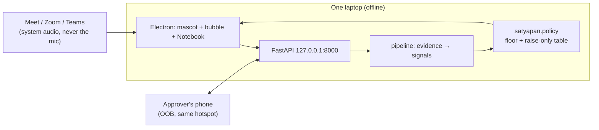

# Engineering deep dive — what we built, and why it is not a wrapper

> This is the document to hand a judge who asks “what did *you* engineer?”. Every claim points
> at code and a test. Measured numbers live in `results/EVIDENCE_LEDGER.md`; the live kit is
> `docs/JUDGE_KIT.md`.

---

## 1. The one-sentence idea

**Satya does not try to prove the voice is fake. It makes sure the payment is real.**

Detectors are allowed to *raise* a band, never lower it. The floor comes from trusted data only:
the maker-entered payment, the company's vendor master and config. A deepfake, a phishing email
or an edited invoice is evidence; evidence can only make the decision stricter.

That inversion is the engineering contribution: it turns an unwinnable detector race into a
verification workflow that still works when the detector is wrong.

---

## 2. Architecture in one picture

- The desktop only relays the policy's `Decision`; it cannot compute a band.
- The backend is the only place detectors run.
- The approver's phone is the only out-of-band channel, and its contact comes from the employee
  directory, never from the message or the call.

Code: `desktop/main/index.ts`, `desktop/renderer/src/companion/`, `src/satyapan/api/companion/`,
`src/satyapan/pipeline.py`, `src/satyapan/policy/`.

---

## 3. The policy engine — the part we are most proud of

### 3.1 Floor from trusted data

`decide(case, master, cfg)` computes a **floor** from:

- the maker-entered `PaymentAction` (amount, beneficiary, account/IFSC/UPI, date),
- the vendor master (is the vendor known? is this account/IFSC/UPI registered? how old is the
  vendor? what is the usual amount? is the vendor inactive?),
- config (limits, de-minimis window).

The floor action types are K1 (know vendor / in pattern), K2 (out of pattern), N1/N2 (new payee,
small/large), C1/C2 (changed beneficiary), and so on. Each maps to PASS / VERIFY / HOLD through
the policy table.

**Evidence never enters `compute_floor`.** It cannot make the floor safer. This is the safety
invariant the tests property-check.

### 3.2 Raise-only signal table

Every detector builds a `Signal` with `Signal.make(code, source=..., evidence_ids=[...])`.
`Signal.make` looks the group/target/strength up in `SIGNAL_TABLE`; a caller cannot type a
target by hand, and the model validator rejects a mismatch. The table's targets are only ever
“raise to VERIFY” or “raise to HOLD” (or informational/NONE). Nothing can lower a band.

- **LLM- or style-sourced signals are capped at VERIFY**; they can never set HOLD.
- A **single weak signal** cannot jump a band.
- A detector crash or parse failure becomes **GREY**, which forces at least VERIFY and a human
  queue. A missing detector can never make a case look safer.
- The maker sees a band and plain-English reasons, never a raw score.

Code: `src/satyapan/contracts/signal_table.py`, `src/satyapan/contracts/evidence.py`,
`src/satyapan/policy/engine.py`, `src/satyapan/policy/bands.py`.
Tests: `tests/invariants/` (monotone, raise-only, LLM cap, floor isolation, OOB/GREY, single weak
signal, no score leak).

### 3.3 Why this is different from “wire an API to a classifier”

A classifier answers “how likely is this fake?”. It cannot answer “should this payment go out?”.
Our system composes multiple **deterministic** signals (sender auth, look-alike domain, invoice
master diff, PDF metadata, asks, screen text, voice/video labels, cross-channel sequence) under a
table that is auditable and property-tested. The policy is the product; the models are inputs.

---

## 4. The ask layer — what the attacker has to say

A payment fraud has to ask for something: pay a new account, change the payee, keep it secret,
skip the approval, read an OTP, install remote access, buy gift cards. Those asks are harder to
paraphrase away than style.

- **Frozen lexicon v1.0** (`asks/lexicon.py`): A1–A7, English + Hinglish + Devanagari. The
  research claim is measured on a lexicon-blind held-out set (`research/heldout/`).
- **Context filter** (`context/`): removes footers, quoted bank OTP notifications and protective
  warnings before the lexicon, because those caused false asks. It is designed on the dev split
  only.
- **Live phrasebook** (`asks/phrasebook.py`, `live-1.1.0`): spoken paraphrases used by product
  surfaces (“add a new payee”, “the account mentioned in my message”, “give me access to your
  desktop”, “screen sharing on karo”). Research scripts never see it.
- **Cues** (RUSH, AUTHORITY, UNREACHABLE, AMOUNT) are highlighted for the user but are **not**
  signals and cannot change a band.

Measured on the pre-registered test split (see `docs/JUDGE_KIT.md`): the product catches at least
one ask in **48.9%** of attack texts with a **12.1%** false-ask rate on benign AP texts. The
floor is what catches the rest.

---

## 5. The channels

| Channel | What we check | Where |
|---|---|---|
| **Live call** | system audio (never the mic), local Whisper, utterance cutting, asks + cues, policy band, OOB | `src/satyapan/live/`, `src/satyapan/adapters/transcribe_local.py`, `desktop/main/capture.ts` |
| **Email** | DMARC/SPF/DKIM from a trusted auth header, look-alike domains, bank impersonation, Reply-To mismatch, free-mail corporate claims, prompt injection is treated as text, never instructions | `src/satyapan/email/` |
| **Invoice / PDF** | extracted IFSC/account/UPI/GSTIN/amount against the vendor master; incremental-update metadata; parse failure → GREY | `src/satyapan/document/` |
| **Screen / clipboard** | on-device OCR or clipboard text, context filter + phrasebook, vendor/account matching, informational card, then evidence | `desktop/main/screen.ts`, `api/companion/service.py::check_text` |
| **Voice note** | local voice model (optional) + transcript asks; missing model is an abstention, not “safe” | `src/satyapan/voice/`, `pipeline._voice` |
| **Video call** | face blend CNN + pulse/lighting/lip-sync cues, raise-only label; no face = abstain | `src/satyapan/video/`, `docs/VIDEO_DEEPFAKE.md` |

### X1 — the cross-channel signal only a companion can produce

Within **30 minutes** in one case: an A1/A7 ask from a call or message **and** a payment to a new
or changed beneficiary → `CROSS_CHANNEL_SEQUENCE` (VERIFY). Add A4 (secrecy) or A5 (bypass) in
the same window → `CROSS_CHANNEL_URGENT_BYPASS` (HOLD). It is deterministic, raise-only,
idempotent and explainable: the detail says how many account/urgency asks were in the window.

Code: `src/satyapan/pipeline.py::derive_cross_channel_signals`.
Tests: `tests/finale/test_x1.py` (boundary, stale, idempotent, raise-only, target table).

---

## 6. Alert → verify → report (the response path)

The step after detection is the product:

1. **Alert card** with the policy band, the exact ask quotes, and one safe next step:
   *Verify with Rajesh* (OOB), *Copy a safe reply*, *Open Notebook*.
2. **OOB-Confirm**: the approver is resolved from the vendor master / employee directory, never
   from message text. A single-use token expires in 10 minutes. the phone page asks the exact
   question: *“Are you on a call with Priya Sharma right now asking for a payment?”* The third
   button is **“I did not request this”**, which maps to DENIED, keeps the case at HOLD and emits
   `oob.result`.
3. **Golden-hour report pack**: five drafts (1930 script, bank fraud desk, NCRP fields, CERT-In,
   BSA §63 Part A) with the UTR on line 1. Every section is `submission = MANUAL_ONLY`,
   `auto_submit = False`. There is no public 1930/NCRP API; a human presses Submit.
4. **Vault**: every file is hashed at intake, the custody chain is append-only, and §63 Part A
   carries the hashes. A draft is not a filed complaint.

Code: `src/satyapan/workflows/oob.py`, `api/routes_verify.py`,
`api/companion/service.py::report_pack`, `src/satyapan/report/`, `src/satyapan/vault/`.
Proof: `scripts/dry_run.py` (consent → live call → alert → OOB “not me” → report pack → stop),
3/3 runs green in `docs/finale/DRY_RUNS.md`; `docs/finale/SAFEGUARDS.md`.

---

## 7. The desktop companion

- Four windows: mascot (click-through, draggable, always on top), bubble (one card), Notebook,
  hidden capture window. Main owns geometry and IPC; the renderer never gets Node.
- **Consent first**: starts asleep; a visible consent card with scopes; per-call yes; never the
  microphone; Hide / Off / Quit stop the session first; any capture error → Sleeping.
- **Three modes**: Watching / Sleeping / Off; the tray and hotkeys work from any state.
- **The bubble is the alert surface**: exactly one card, passive cards use `showInactive()` so
  Meet keeps focus, Esc dismisses, the height follows content.
- **Notebook**: Now, Cases, Timeline, Evidence, Reports, Privacy, Settings. The expert view shows
  the floor, each raising signal and the policy version — no raw scores.

Code: `desktop/main/`, `desktop/preload/`, `desktop/renderer/src/companion/`,
`desktop/renderer/src/workspace/`.
Tests: `desktop/tests/*.test.ts` (84 vitest tests green).

---

## 8. Off-the-shelf vs our code (say this honestly)

| Off-the-shelf | Our code |
|---|---|
| Electron, React, Tailwind, Framer Motion | the four-window companion, consent/mode state machine, bubble placement, click-through/drag |
| FastAPI, Pydantic, SQLite | the companion protocol, SSE bus, OOB flow, report pack |
| Whisper / faster-whisper (local) | the capture path, utterance cutting, fan-in, asks/cues, fail-closed status |
| MediaPipe face landmarks, EfficientNet-B0, ONNX Runtime | the video windowing/fusion/rules and the raise-only policy label (see `docs/VIDEO_DEEPFAKE.md`) |
| `pypdf` text extraction | the invoice field regexes, master diff, PDF-edit heuristic |
| stdlib `email` | the auth-header parsing, domain/identity checks, grey rules |

We did **not** fine-tune a language model for the ask layer. It is a deterministic, auditable
pattern system with a measured held-out result — that is deliberate: it can run offline, it can
explain every hit, and it cannot be prompt-injected into lowering a band.

---

## 9. The 3-minute code walkthrough (any member can give this)

| Minute | Open | Say |
|---|---|---|
| 0:00 | `src/satyapan/policy/engine.py` | “The floor comes from the payment and the vendor master; evidence is not an input here.” |
| 0:30 | `src/satyapan/contracts/signal_table.py` + `Signal.make` | “Every detector must use the table. It cannot type a target. Every target only raises.” |
| 1:00 | `src/satyapan/pipeline.py` | “Evidence → detector → signals → merge → recompute. A crash becomes GREY, never PASS.” |
| 1:30 | `src/satyapan/pipeline.py::derive_cross_channel_signals` | “This is X1: a call ask plus a new payee inside 30 minutes. Only a companion sees both.” |
| 2:00 | `src/satyapan/workflows/oob.py` + `api/routes_verify.py` | “The approver is from the directory, the token is single-use, ‘not me’ keeps HOLD.” |
| 2:30 | `src/satyapan/report/` + the Reports tab | “Five drafts, UTR first, `MANUAL_ONLY`. Nothing is filed by code.” |
| 3:00 | `tests/invariants/` + `make judge` | “These are property tests, not examples. Here is the measured scoreboard.” |

---

## 10. Questions a judge may ask

**“Isn’t this just a wrapper around Whisper and a classifier?”**
No: the policy engine, signal table, floor, X1, ask/context/phrasebook, email/invoice/screen
checks, OOB flow, vault and report pack are our code. Whisper is one input; it cannot set a band.

**“Why not just fine-tune a detector?”**
We do use models where they help (voice, video), but the decision needs to be explainable,
offline, raise-only and robust to a model being wrong. The floor is the control that still works
when the detector misses.

**“What happens when the model is wrong?”**
It can fail to raise a band (a miss) or raise a false alarm (a false positive). It cannot lower
the floor. The alert budget measures both: 3.5% routine HOLD false alarms, 78.6% of attacks at
≥ VERIFY. The named misses are in `docs/JUDGE_KIT.md`.

**“Can the LLM change the decision?”**
No tools, no band, prompt-isolated, capped at VERIFY, faithfulness-checked, and the template
fallback is always available. Prompt-injected text is treated as data.

**“Where does the approver’s number come from?”**
The vendor master / employee directory. Never from the email, the call or the message. A phone
number inside an attack message is never used.

**“Does it file the complaint?”**
No. There is no public 1930/NCRP API, and a human must stand behind a police complaint. Satya
drafts; a human submits.

**“What is measured?”**
See `results/EVIDENCE_LEDGER.md`: the ask extractor on a lexicon-blind held-out set, the alert
budget through the real pipeline, the Seal codec tests, the decision-relevance table, and the
judge kit. Every row has n, a 95% interval where it is a proportion, and a command.

**“What did you cut?”**
See `docs/finale/DELIVERED.md`: route B (system-audio loopback) is P1 and platform-dependent;
Gmail “Ask Satya” is P2; the human dry runs and the pitch deck are the remaining P0 items.
