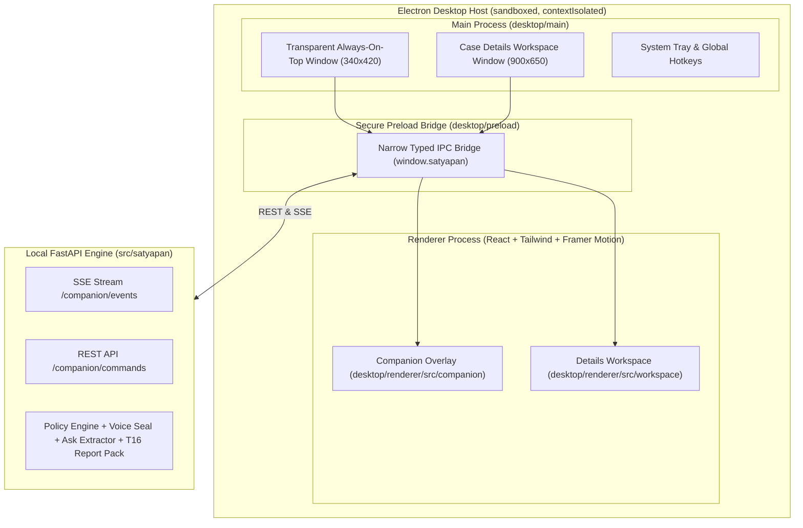

# Satyapan "Pahredaar" (Satya) — Grand Finals Master Architecture & Spec
## Amazon Raksham Deepfake Detection Track · IIT Delhi Grand Finals

---

## 1. Executive Summary: Defense in Depth, Not Certainty

**Pahredaar / Satya** is a consent-first desktop companion that helps an accounts-payable maker pause, verify a request through a trusted independent channel, and preserve evidence when asked. It is not an identity oracle, a guarantee that synthetic speech will be detected, or a control that can stop activity in unrelated banking software.

The architecture combines independent safeguards:
* **Payment floor:** The existing policy engine evaluates trusted transaction, vendor-master, and configuration data. Evidence may raise the band; companion UI and models never set or lower it.
* **Intent and evidence signals:** Existing deterministic ask extraction and evidence checkers can identify suspicious content, but are fallible. Language, accent, emotion, poor audio quality, and a missing voice seal are not proof of fraud or identity.
* **Provenance:** A verified seal can support a provenance claim only within its documented protocol and validation limits. Passkey authentication, a watermark, a device key, and a statutory certificate are different mechanisms; do not present them as interchangeable.
* **Independent confirmation:** For sensitive changes, route a transaction-bound confirmation to a known contact using the trusted employee/vendor directory—not a number supplied in the suspicious call or message.
* **Scribe:** Prepare evidence-linked, editable incident drafts. The user verifies details and submits them manually if appropriate.

### Assurance boundary

Audio classifiers and speech recognition are probabilistic. A hash chain can show that retained bytes have not changed since hashing; it cannot prove who spoke, that the original capture was complete, or that the content is true. A locally generated evidence dossier is technical integrity support, not a promise of admissibility or a substitute for the applicable Bharatiya Sakshya Adhiniyam Section 63 process. Have Indian counsel validate the prescribed certificate fields and signatories before describing an output as compliant. “Golden hour” is a response-design goal, not a statutory deadline or recovery guarantee. Nothing is automatically reported or submitted.

---

## 2. Desktop Architecture & Window Lifecycle



### Window Management & Security:
1. **Two Windows:**
   - **Companion Window:** Frameless, transparent, draggable, always-on-top (`transparent: true, frame: false, alwaysOnTop: true`).
   - **Details Workspace Window:** Regular window for in-depth case inspection, evidence custody chains, and audit logs. Opens on double-click or "Inspect" action.
2. **Sandboxing:** Context isolation enabled, Node integration disabled. Renderer talks exclusively through a narrow, typed `preload.ts` bridge (`window.satyapan`).
3. **Default Launch State:** Always launches into **Sleep / DND**. It never monitors without explicit user consent.

---

## 3. Companion State Machine (6 States)

| State | Visual treatment | Capture / processing | Evidence scope | Trigger / transition |
|---|---|---|---|---|
| **Sleep / DND (Default)** | Resting, low-motion, no attention-seeking cues | OFF; capture released | No monitoring or analysis | App startup, user clicks Sleep, or a permission/device failure occurs. |
| **Active / Watching** | Calm, attentive, persistent “Watching [source]” indicator | ON only for the explicitly selected source | User-consented source only | User starts a session after seeing the source and permission scope. |
| **Investigating** | Focused progress with a cancel control | Process only the submitted/currently consented evidence | Show source, time range, and status; no hidden screen scraping | A scoped detector event or user-requested email/document analysis starts review. |
| **Alert / Alarm** | Serious, calm shield; plain-language card; no siren or panic animation | No new analysis is implied by the alert | Show observed reason(s), uncertainty, and evidence references | Backend event arrives. Missing seal or one weak detector result alone is not an identity accusation. |
| **Scribe** | Deliberate typing animation with visible source citations and draft status | Pause new capture by default; offer a separate explicit resume control | Draft only from selected/custodied evidence and user-confirmed facts | User asks to prepare a draft. Outputs remain editable and `MANUAL_ONLY`. |
| **Disabled** | Removed from the screen | OFF; capture and session resources released | No monitoring | User chooses Disable/Exit. A separate Hide action must not leave monitoring active invisibly. |

*Safety guardrail:* A global **"Stop Watching"** control exists in every state. Permission errors or device disconnects immediately stop capture and fail closed to **Sleep / DND**. Provide reduced-motion, keyboard, and screen-reader equivalents; color or sound is never the only indication.

### 3.1 Psychological Intervention: A Cognitive Pause, Not Coercion

The goal is to interrupt urgency and authority pressure with a clear, low-arousal pause—not to frighten, shame, or trap the clerk. “Unavoidable” cannot be promised: Satya cannot prevent a person from using another application, and it must not hijack keyboard input, disable a bank’s Send button, impersonate a bank screen, or make a dismissible alert impossible to dismiss.

When a backend alert arrives, present a short, persistent-but-dismissible card:

1. **Pause:** “Pause before changing the beneficiary or sending this payment.”
2. **Observed facts:** Name the detected request or mismatch and its evidence/time range. Say explicitly that this does not prove who is speaking. Avoid raw scores, accusatory labels, and unsupported certainty.
3. **Safe next action:** Make **“Verify using a saved contact”** the primary action. The destination comes only from the trusted employee/vendor directory. Never use the phone number, link, or contact method supplied in the suspicious message or call.
4. **Usable refusal script:** Offer a one-tap-to-copy sentence such as, “I need to verify this through our registered callback process; I’ll get back to you.” It does not disclose a challenge or sensitive internal data.
5. **Deliberate acknowledgement:** In Satya’s own case/payment workflow, require an explicit user choice to record whether verification was completed before proceeding to the next in-app step. This is not a lock on external net-banking software. Preserve the alert in the case timeline even if dismissed.

Keep Active calm and unobtrusive; Investigating transparent about what it is processing; Alert firm but non-alarming; and Scribe methodical, showing provenance and draft status. Use at most one optional, user-configurable cue (visual, sound, or haptic where supported); avoid repeated sirens that create alarm fatigue or interfere with the call. Measure comprehension and action in consented role-play dry runs before claiming the design changes behavior or prevents payments.

### 3.2 Adversarial Audio, Quality Gates, and Live-Demo Fallback

The audio path must distinguish **what was said** from **whether a voice has a verified provenance signal**. Hindi/Hinglish, a regional accent, emotion, background speech, or a codec artifact must never be treated as evidence of fraud by itself. A missing seal means “not verified by this seal,” not “synthetic.” The team must not claim that a classifier catches a particular commercial voice generator until a versioned, held-out evaluation supports that claim.

#### Bounded live pipeline

1. **Consent and source identity:** Start only after the user selects a source and grants the OS permission. Record session/source IDs and the actual capture format. Do not silently switch from a chosen app to microphone or system-wide capture.
2. **Sequence before inference:** Give every chunk a monotonically increasing sequence number and capture timestamps. Use a bounded jitter buffer sized from measured T18 channel data. Detect late, missing, duplicate, and out-of-order chunks. Never silently stretch, interpolate, or concatenate a gap and then call the result continuous evidence.
3. **Quality telemetry:** Track format, duration, silence/VAD, clipping, discontinuity/drop counts, and conservative noise-quality estimates. Mark a window `usable`, `degraded`, or `incomplete`; these are capture-coverage statuses, not fraud bands. Keep the original captured bytes unchanged when preservation is explicitly requested. Any resampled, denoised, or transcoded copy is a separately hashed derivative with its parent and transform recorded. Do not apply aggressive denoising before spoof analysis unless that exact transform has been evaluated: it can erase or invent artifacts.
4. **Separate analysis paths:** Run speech/ask extraction and any acoustic/provenance detector as independent evidence producers. Treat uncertain ASR as uncertain; never let the UI turn a guessed transcript into a quotation. Attach time ranges and evidence IDs to extracted content. Accent or language identification is routing metadata only, never a risk feature.
5. **Quality-aware abstention:** Run acoustic inference only on channel conditions represented in validation. If quality is degraded or the stream has gaps, abstain from an acoustic conclusion and show that coverage is incomplete. Do not translate low quality, a missing seal, or a detector score directly into an Alarm. Existing backend signals and the policy engine remain the only route to a band; signals are created through the approved `Signal.make(...)` path, and no maker sees raw scores.
6. **Bounded latency and storage:** Keep only a short, consented in-memory analysis buffer by default. Persist evidence only through an explicit preserve-evidence action and the existing custody path. If processing falls behind, discard stale inference windows with explicit gap markers rather than building an unbounded queue. Do not send audio to a cloud service as an automatic fallback.

#### Red-team matrix and required behavior

| Judge/input condition | Expected safe behavior |
|---|---|
| Hindi/Hinglish, code-switching, unfamiliar accent | Preserve language uncertainty; do not label accent as suspicious. Ask the user to verify if the content or other evidence warrants it. |
| Fan noise, room echo, clipping, low volume | Mark coverage degraded and abstain from unsupported acoustic conclusions. Do not produce a fraud alarm from noise alone. |
| Meet/Teams/phone codec, resampling, speaker playback | Test each actual capture route and codec in T18. Calibrate per route or abstain; do not reuse clean-audio thresholds as if equivalent. |
| High-quality synthetic voice with neutral content | Do not claim guaranteed detection. A missing/unavailable seal is “unverified”; use independent transaction verification rather than identity certainty. |
| Synthetic voice plus urgent beneficiary/payment change | Surface the independently detected request evidence and guide the user to trusted OOB verification. The policy engine decides any escalation; the detector does not decide identity. |
| Jitter, device disconnect, OS permission revoked | Mark the affected interval incomplete, stop or pause capture, visibly report the failure, and offer trusted callback/manual verification. Never silently fill the gap. |

For red-team evidence, use consented or generated test material, record the exact codec/noise transforms and model versions, and keep speaker/source splits disjoint. Report false-alert and miss rates with sample counts and confidence intervals. If a scenario has not been tested, state that limitation instead of improvising a performance number.

#### Three-minute pitch resilience

Keep the demo’s inference path local so internet loss does not stop the primary demonstration. Before a **LIVE** run, perform a capture-permission and continuity preflight. If loopback health falls outside limits measured on the target device, stop presenting it as live and switch to a local, deterministic replay fixture. Put a persistent **“DEMO REPLAY — NOT LIVE CAPTURE”** label on the UI; use fake identities and fake transaction data. Do not claim that replay is a live detection. Keep a short screen recording and a verbal/manual walkthrough as further fallback. In a real incident, the safe fallback is to pause the payment and use a trusted callback—not to trust a stale or partial audio result.

### 3.3 Reverse Challenge Through Independent OOB Confirmation

Do **not** make the clerk ask the suspicious caller a “secret question.” Knowledge questions can be learned, guessed, elicited by social engineering, or relayed to a live voice clone; they create false confidence. A challenge spoken on the same call is not an independent factor. Satya’s countermeasure is to challenge the *transaction* through a separately trusted path, using the existing OOB-Confirm workflow.

1. **Create a transaction-bound request:** Bind a one-time challenge ID/nonce to a canonical snapshot of the requested action (vendor/payee identity, amount/currency, action such as beneficiary change, and masked destination reference). Expire it after a short, policy-configured interval; make it single-use and idempotent. The nonce prevents replay and binds the approval to this request; it is not proof of identity by itself.
2. **Resolve the approver independently:** Select the approver and callback destination from the employee directory or trusted vendor master. Never use a number, link, or “new contact” in the suspicious message/call. Prefer a pre-enrolled authenticated approval channel distinct from the originating communication. If that channel is unavailable, give the clerk a one-click path to call the directory-listed number and read back the exact transaction for confirmation.
3. **Show the approver the actual intent:** The approver sees the vendor, amount/currency, requested change, and masked destination, then chooses **Approve this exact request**, **Reject**, or **I did not request this**. A generic “yes,” a voice resemblance, or successful answer to a personal question is not sufficient. Do not disclose a code or challenge answer to the original caller.
4. **Handle no response safely:** Timeout, unreachable approver, mismatched details, or an untrusted route means **not verified**. Keep the request pending and recommend the team’s established escalation process; never convert silence into approval. A response does not itself lower a band—any clearance must go through the existing policy/clearance flow.
5. **Keep an auditable, minimal record:** Record challenge ID, transaction digest, target directory identity/reference, delivery route, issue/expiry times, response, response-channel authentication result, and evidence IDs. Do not log reusable secrets or unmasked account data in UI text. The event is an OOB result for the policy/workflow layer, not a UI-set risk decision.

This gives the clerk a practical counter-script—“I’ll verify the exact request through our registered channel”—without trying to outsmart the clone acoustically. If the organization has no independent, pre-enrolled route, the system must say verification is unavailable rather than inventing one.

---

## 4. Frontend ↔ FastAPI Contract

All messages use versioned envelopes. REST for commands, SSE for live state push. Audio bytes are transmitted as multipart binary (`audio/wav`), never base64 in JSON.

### A. Analysis Command: `POST /companion/submit-evidence`
```json
{
  "version": "1",
  "request_id": "req_demo_001",
  "type": "evidence.text.submit",
  "session_id": "session_demo_001",
  "payload": {
    "source": "user_selected_email",
    "consent_id": "consent_demo_001",
    "text": "Please review the requested beneficiary change using the registered callback process.",
    "evidence_id": "ev_text_001"
  }
}
```

### B. Live State Event: `GET /companion/events` (SSE Stream)
```json
{
  "version": "1",
  "event_id": "evt_9901",
  "type": "alert.raised",
  "session_id": "session_demo_001",
  "occurred_at": "2026-10-21T23:50:00Z",
  "payload": {
    "state": "ALERT",
    "mascot_mood": "calm_alert",
    "band": "VERIFY",
    "headline": "Request needs independent verification",
    "explanation": "A sample beneficiary-change request needs review. This evidence does not establish the caller's identity.",
    "reason_codes": ["DEMO_ONLY_REASON_CODE"],
    "evidence_ids": ["ev_audio_001"],
    "next_actions": [
      {"id": "oob_verify", "label": "Verify using a saved contact", "variant": "primary"},
      {"id": "open_scribe", "label": "Prepare an incident draft", "variant": "outline"},
      {"id": "open_workspace", "label": "View Details", "variant": "outline"}
    ]
  }
}
```

---

## 5. 4-Person Ownership Boundaries & Folder Layout

```
repository/
├── desktop/
│   ├── main/                 # [Shivendra] Electron window lifecycle, tray, security
│   ├── preload/              # [Shivendra] Typed contextBridge (window.satyapan)
│   ├── capture/              # [Kartikey] System audio loopback & fake capture adapter
│   └── renderer/
│       ├── src/
│       │   ├── companion/    # [Saarika] Mascot animations, moods, speech bubbles
│       │   ├── workspace/    # [Saksham] Case details window, telemetry, audit logs
│       │   └── assets/       # [Saarika] Mascot SVGs and synthesized audio chimes
├── src/satyapan/
│   ├── api/
│   │   └── companion/        # [Shivendra & Kartikey] SSE router & evidence ingest
│   └── report/               # [Kartikey] BSA Sec 63 + 1930 script generation
└── tests/tasks/
    └── test_t25_companion.py # [Shivendra] Acceptance suite
```

### The 3 Mockable Interfaces (Enabling Parallel Work with Weak Models):
1. **`CompanionApiClient`:** Emits mock SSE events (`ALARM`, `WATCHING`, etc.) so Saarika and Saksham can test the full UI without running the Python backend.
2. **`CaptureSource`:** A fake audio generator producing 5-second PCM test chunks so Kartikey and Shivendra can test audio routing without needing a live Google Meet call.
3. **`ReportDraftClient`:** Returns static Section 63 and 1930 drafts for instant UI testing of "The Scribe".

---

## 6. Golden-Hour Evidence Dossier: Integrity and Provenance

### What the cryptography does—and does not prove

There is no “mathematically unassailable” recording. Cryptography can make later edits detectable and identify which key signed a manifest. It cannot prove the original capture was complete, the device clock was correct, the speaker was genuine, or a statement was true. A device key certificate is not automatically a BSA certificate. Treat the dossier as tamper-evident technical support; have qualified Indian counsel validate the applicable Section 63 form, required statements, process, and signatories before claiming statutory compliance or admissibility.

Record only after explicit evidence-preservation consent. Live inference may use a bounded volatile buffer; do not imply that unretained audio can later be certified. Preserve the exact captured bytes at the capture boundary when the user elects to retain them. Every normalized, denoised, transcoded, or transcribed object is a **derived artifact**, with its own digest, parent IDs, tool/model version, and transformation description. Never replace the original with a processed copy.

### Version 1 dossier layout

```text
dossier/
├── manifest.json                 # canonical metadata + chunk/derivative inventory
├── chunks/                       # exact retained capture bytes, if preservation was authorized
├── derivatives/                  # transcript and any transformed audio, each separately hashed
├── manifest.cose                 # detached COSE_Sign1 signature, if a trusted key is available
├── certificates/                 # signer/device certificate chain and key-attestation evidence, if available
├── custody.jsonl                 # append-only custody/export/verification events
├── section63-draft.json          # counsel-reviewed field mapping; never auto-certified
├── helpline-1930-draft.json      # separate user-reviewed call aid; MANUAL_ONLY
└── verification-report.json      # verifier result, gaps, key/time trust limits
```

Example `manifest.json` structure (all IDs and digest strings below are placeholders, not evidence):

```json
{
  "schema": "satyapan.evidence-dossier/v1",
  "dossier_id": "demo-dossier-001",
  "case_ref": "case-demo-001",
  "created_at_utc": "2026-10-21T12:00:00Z",
  "clock": {
    "wall_clock_source": "OS_CLOCK",
    "sync_status": "UNVERIFIED_LOCAL_CLOCK",
    "estimated_uncertainty_ms": null,
    "monotonic_origin": "SESSION_START"
  },
  "capture": {
    "session_id": "session-demo-001",
    "consent_receipt_sha256": "EXAMPLE_ONLY_NOT_A_DIGEST",
    "source": {"kind": "USER_SELECTED_LOOPBACK", "label": "DEMO_SOURCE"},
    "device": {
      "platform": "DEMO_ONLY",
      "app_build": "DEMO_BUILD",
      "key_id": "device-key-demo",
      "key_provider": "OS_KEYSTORE",
      "hardware_backed": false,
      "certificate_chain_sha256": []
    },
    "format": {
      "captured_encoding": "PCM_S16LE",
      "sample_rate_hz": 16000,
      "channels": 1
    }
  },
  "chunks": [
    {
      "sequence": 0,
      "path": "chunks/000000.bin",
      "byte_length": 0,
      "capture_start_utc": "2026-10-21T12:00:00Z",
      "capture_end_utc": "2026-10-21T12:00:05Z",
      "monotonic_start_ns": 0,
      "monotonic_end_ns": 5000000000,
      "gap_before": false,
      "chunk_sha256": "EXAMPLE_ONLY_NOT_A_DIGEST",
      "chain_sha256": "EXAMPLE_ONLY_NOT_A_DIGEST"
    }
  ],
  "gaps": [],
  "derivatives": [
    {
      "artifact_id": "transcript-demo-001",
      "path": "derivatives/transcript.json",
      "kind": "ASR_TRANSCRIPT",
      "sha256": "EXAMPLE_ONLY_NOT_A_DIGEST",
      "derived_from": ["chunk:0"],
      "engine": "ENGINE_ID_AND_VERSION_REQUIRED",
      "time_ranges_required": true
    }
  ],
  "hash_profile": {
    "digest": "SHA-256",
    "canonical_json": "RFC8785_JCS_UTF8",
    "chunk_domain": "SATYAPAN:T25:CHUNK:v1",
    "chain_domain": "SATYAPAN:T25:CHAIN:v1",
    "manifest_domain": "SATYAPAN:T25:MANIFEST:v1"
  },
  "chain_root_sha256": "EXAMPLE_ONLY_NOT_A_DIGEST",
  "signature": {
    "format": "COSE_Sign1",
    "algorithm": "ES256",
    "protected_key_id": "device-key-demo",
    "signature_path": "manifest.cose",
    "certificate_trust_status": "UNVERIFIED_DEMO_KEY"
  },
  "time_anchor": {"kind": "NONE", "receipt_path": null},
  "custody_log_sha256": "EXAMPLE_ONLY_NOT_A_DIGEST",
  "section63_support": {
    "status": "DRAFT_REQUIRES_COUNSEL_AND_SIGNATORY_REVIEW",
    "record_description": "USER_CONFIRMED_DESCRIPTION_REQUIRED",
    "production_method": "CAPTURE_METHOD_AND_TRANSFORMS_REQUIRED",
    "device_particulars_ref": "capture.device",
    "prescribed_form_version": "COUNSEL_VERIFIED_VERSION_REQUIRED",
    "signatory": null
  }
}
```

### Canonical digest and verification rules

For each chunk, construct a UTF-8 RFC 8785 canonical header containing dossier/session IDs, sequence, UTC and monotonic boundaries, exact captured format, byte length, and `gap_before`. Let `H` be those canonical header bytes and `B` be the exact retained chunk bytes:

```text
chunk_hash[i] = SHA256(
    UTF8("SATYAPAN:T25:CHUNK:v1") || 0x00 ||
    UINT64_BE(length(H)) || H || B
)
chain[0] = SHA256(UTF8("SATYAPAN:T25:CHAIN:v1:ROOT") || 0x00 || canonical_session_header)
chain[i] = SHA256(
    UTF8("SATYAPAN:T25:CHAIN:v1:LINK") || 0x00 ||
    chain[i-1] || UINT64_BE(sequence[i]) || chunk_hash[i]
)
manifest_hash = SHA256(
    UTF8("SATYAPAN:T25:MANIFEST:v1") || 0x00 ||
    RFC8785(canonical_manifest_core_without_signature_and_anchor)
)
```

The implementation must pin integer width/endianness, canonicalization version, byte framing, domain strings, and which manifest fields are signed; publish test vectors and reject unknown versions. Sign `manifest_hash` in COSE_Sign1 with ES256 only when the key can actually perform that operation. Keep the private key non-exportable in the OS keystore where supported. Record `hardware_backed` as a measured property, not an assumption. Include the certificate chain and attestation evidence when available; a self-signed key proves possession of that key, not the identity of a trusted organization/device. If no trusted issuer or attestation exists, say so in the verification report.

Use UTC wall time **and** a monotonic offset for ordering. Record synchronization source/status and known uncertainty; a local timestamp is not a trusted timestamp. A trusted timestamp authority receipt or remote append-only anchor may be attached when actually configured, but must never be fabricated or implied by a local hash chain. Any sequence gap is explicitly listed; verification must fail completeness checks rather than silently treating a partial stream as whole. Verification recomputes every file digest, checks order/gaps, chain root, signature/certificate status, and derivative lineage, then emits a verification report with any failures and limitations; sign that report only if a configured trusted signing key is available.

### Separate user-facing incident drafts

`section63-draft.json` maps the evidence inventory to a counsel-verified Section 63 certificate template. Its status remains `DRAFT_REQUIRES_HUMAN_REVIEW` until the proper person confirms the record, process, device particulars, and prescribed statements and signs through the required process. A digest alone does not complete those legal steps.

`helpline-1930-draft.json` is a separate, versioned call aid with `submission: "MANUAL_ONLY"`, case/evidence references, user-confirmed facts, source/provenance for each field, and review status. It may include the pronunciation helper `1930 → “one nine three zero”`; it must not invent a UTR, account, loss, or caller identity. Keep sensitive references masked in the UI and disclose them only when the user deliberately reviews the appropriate official process. Do not automatically dial, transmit, or file anything.

## 7. Grand Finals 3-Minute Live Demo Script

* **0:00–0:30 — Consent and mode:** Satya starts in **Sleep / DND**. The operator selects the demo source and grants capture permission. Show the preflight result and a persistent **LIVE** or **DEMO REPLAY** indicator. If capture is not healthy, use replay from the start rather than pretending a fixture is live.
* **0:30–1:20 — Request and cognitive pause:** Play a consented/generated synthetic demo voice using fake data and a beneficiary-change/urgency scenario. If live capture jitters or loses permission, show the incomplete interval, stop that path, and switch to the explicitly labeled local replay fixture. The example alert says that a request needs verification and cites its evidence; it does **not** claim that a missing seal proves a clone or that the UI itself set a band.
* **1:20–1:50 — Reverse challenge:** Open the OOB test approver on a second device/account populated only with demo data. Show the exact masked demo transaction, then have the test approver reject it. Do not represent a real executive or claim that voice similarity authenticated anyone.
* **1:50–2:35 — Scribe:** The operator explicitly chooses to preserve the selected demo evidence and reviews the generated bundle. Show chunk/gap status, hashes, and the verifier result. Label the Section 63 mapping **DRAFT — HUMAN / COUNSEL REVIEW REQUIRED** and the 1930 call aid **MANUAL_ONLY**. Do not show real UTRs, bank details, or personal data; do not auto-dial or submit.
* **2:35–3:00 — Honest close:** Explain the measurable design claim: Satya makes monitoring consent-visible, reports coverage failures, routes sensitive requests to an independent trusted confirmation, and detects post-capture file changes. It does not promise detection of every clone, prove speaker identity from a voice score, block external banking software, or guarantee legal admissibility.

### Stage preflight and judge challenge cards

Before doors open, verify the target OS permission, chosen loopback source, audible passthrough, chunk continuity, local backend, saved replay fixture, and screen-recording backup. The operator must be able to switch modes in one visible action. Rehearse these judge challenges with the expected response:

| Challenge | Show / say |
|---|---|
| Strong Hindi/Hinglish synthetic voice | “We do not claim universal clone detection. Here is the independent transaction challenge and its result.” |
| Fan noise, echo, or a compressed call | Show degraded coverage and abstention; do not manufacture an Alarm from poor quality. |
| Jitter or network disconnected | Show the gap and local-only behavior; switch to labeled replay if live capture cannot continue. Internet loss must not silently trigger cloud upload. |
| Missing seal or unknown caller | Say “not verified by this seal”; use the registered callback/OOB path. Do not identify the voice as fake. |
| Judge asks whether the file is “court-admissible” | Show digest verification and limitations; explain that the required Section 63 certificate/form and signatory need applicable legal review. |

Use the same fixture and exact UI mode label in every rehearsal. Never describe fixture playback as a real call or present unmeasured detection accuracy as a result.
