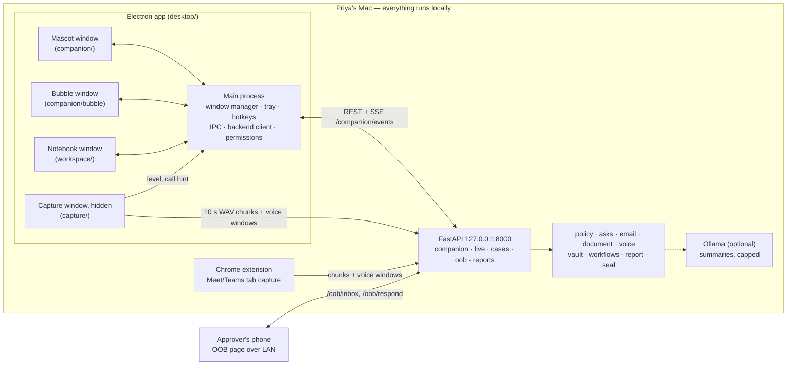
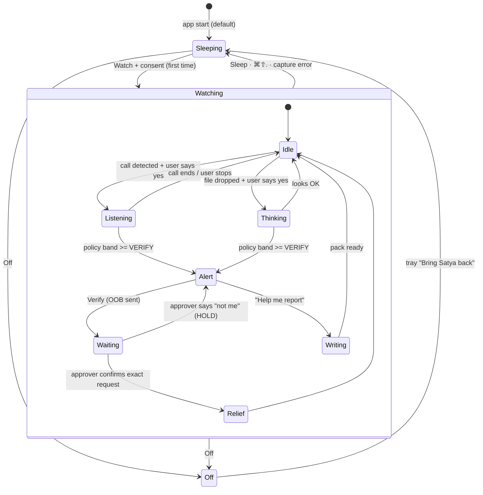

# Satya — Grand Finale Architecture (v2)

> **Single source of truth for the finale build** (RAKSHAM, IIT Delhi, 24–25 Oct 2026).
> 48-hour plan, demo and timeline: [`docs/finale/PLAN.md`](finale/PLAN.md).
> Mascot art, motion and copy: [`docs/finale/MASCOT_SPEC.md`](finale/MASCOT_SPEC.md).
> Your tasks: `team/<YourName>.md`. Rules for every agent: `AGENTS.md`.

---

## 0. The pitch in one breath

**Satya** is a tiny, cute guardian that sits on a finance clerk's screen.
It listens to a call only when you say yes. It reads an email only when you hand it over.
It connects the dots across channels, and makes you verify through a channel the fraudster cannot touch.
If money already left, it writes your golden-hour report pack in under a minute.
**A human always presses Submit.**

Problem statement: **03 — Deepfake Detection for Financial Communications** ("verify financial
communications, detect manipulation, and create an actionable path for review, reporting, or response").
It also covers parts of 01 (voice clone on calls) and 02 (scam workflow across channels).

---

## 1. What we keep, what we change

**Keep (already built, ~700 tests green).** Policy engine (floor + raise-only bands), ask extractor
(A1–A7, EN/Hinglish/Devanagari), email / invoice / voice-note checkers, evidence vault + custody
chain, OOB-Confirm, callbacks, report pack (UTR-first), Satyapan Seal, live transcript path (T11),
Chrome extension tab capture (T07), companion API + SSE bus (T25 backend).

**Change: the desktop shell.** Today one 380×500 window shows the mascot *and* all the cards all
the time, so "the whole webpage roams around the screen". The new shell has **three windows**:

| Window | When visible | What it shows |
|---|---|---|
| **Mascot** | always (unless Off) | only Satya + a tiny radial menu when clicked |
| **Bubble** | only when Satya needs to say something | exactly one card (consent, alert, result…) |
| **Notebook** | when the user opens it | everything: cases, timeline, vault, reports, privacy |

**New features for the finale.**
1. Three user modes: **Watching / Sleeping / Off** (what the user asked for).
2. Call listening through **system audio** (any app) with **per-call consent**, plus the existing
   Chrome-tab route.
3. **"Should I read this?"** — drag an email, invoice or voice note onto Satya.
4. **Live chips** during a call, and a calm **alert card** with one safe next step.
5. **Verify with one tap** (OOB-Confirm) from the alert — the real approver answers on their phone.
6. **Scribe**: Satya puts on glasses and writes the golden-hour pack, with an animation.
7. **Report Copilot**: a checklist for 1930, the bank, cybercrime.gov.in, CERT-In and the
   BSA §63 certificate draft, with copy buttons and a golden-hour timer.
8. **Notebook**: the info tab where every action Satya took is logged and visible.

---

## 2. Who it is for, and the threat

**Primary user — Priya**, accounts executive (maker) at an Indian SME with 50–500 staff.
**Approver — Rajesh**, the CFO. **Checker — Arjun.** **Security — Meera.** (All fictional.)

| # | Attack | Channel | What Satya does |
|---|---|---|---|
| T-1 | Deepfake "CFO" voice/video: urgent, secret transfer to a new account | Meet / Teams / Zoom / WhatsApp / phone via Mac | live chips → alert → verify on a saved contact |
| T-2 | Compromised or look-alike vendor mailbox; bank details changed; edited invoice PDF | email + PDF | dropped file → checks → "account differs from vendor master" → call vendor on registered number |
| T-3 | Cloned voice note ("send it now, I'm in a meeting") | WhatsApp voice note | dropped audio → voice + ask checks |
| T-4 | Money already left | — | Scribe + Report Copilot inside the golden hour |

**Why a companion and not a dashboard.** Fraud happens *across* apps, at the moment of decision.
A dashboard is opened after the damage. Satya is already on the screen when the call happens, and
it sees more than one channel, so it can link "the call asked for a new account" with "an email
with new bank details arrived 10 minutes later".

---

## 3. System overview



**Network.** Audio never leaves the laptop. The only other device is the approver's phone, which
opens the OOB page over the local network (or a phone hotspot on stage). SES email only if AWS
mode is on.

---

## 4. Desktop: four windows, one main process

All windows: `contextIsolation: true`, `sandbox: true`, `nodeIntegration: false`, one preload
(`window.satyapan`), CSP `default-src 'self'; connect-src http://127.0.0.1:8000`.
The renderer picks its view from `?view=` in `App.tsx`.

| Window (`?view=`) | Size | Electron options (key ones) | Owner |
|---|---|---|---|
| `companion` (mascot) | 280×280 | `transparent`, `frame: false`, `alwaysOnTop('floating')`, `skipTaskbar`, `focusable: false`, `hasShadow: false`, visible on all workspaces incl. full-screen | Shivendra (window) / Saarika (content) |
| `bubble` | 360 × auto (max 480) | `transparent`, `frame: false`, `alwaysOnTop('floating')`, `skipTaskbar`, focusable, hidden by default | Shivendra (window) / Saarika (content) |
| `workspace` (Notebook) | 1120×720 (min 900×600) | normal window, `titleBarStyle: 'hiddenInset'` | Saksham |
| `capture` | 1×1, `show: false` | `backgroundThrottling: false` | Kartikey |

### 4.1 The mascot window (the fix for "the webpage roaming around")

- The window is 280×280 but **almost all of it is click-through**. Satya is drawn 96 px in the
  centre; the extra space is only for the radial menu and the ear "sound rings".
- **Click-through:** main calls `setIgnoreMouseEvents(true, { forward: true })`. When the pointer
  enters Satya or a menu petal, the renderer calls `satyapan.setClickThrough(false)`; on leave,
  `true`. Clicks on empty space go to the app behind.
- **Drag:** pointer-down on Satya, move > 4 px → renderer sends `dragBy(dx, dy)` every animation
  frame → main moves the window. Release → snap to the nearest screen edge if within 24 px,
  save position to `userData/satya.json`. Satya squashes a little while dragged.
- **Click** (no movement, < 250 ms) → radial menu blooms. **Double-click** → Notebook.
  **Right-click** → native context menu (all actions, including Off and Quit).
- **Hover** → Satya looks at the cursor and twitches an ear. Cursor position comes from main
  (`screen.getCursorScreenPoint()` at 30 Hz, only while visible).

### 4.2 The bubble window

- Shows **exactly one `BubbleCard`** (contract in §9). Never a stack of cards.
- Placed beside Satya: to the left if Satya is on the right half of the screen, else to the right;
  moved up if it would go off-screen. Main recomputes after every drag.
- Passive cards (live chips, toasts) use `showInactive()` so they never steal focus from the call.
  Cards that need an answer use `show()`.
- Height follows content (`ResizeObserver` → `resizeBubble(h)`). `Esc` dismisses dismissible cards.
- Toasts auto-hide after 4 s. Alert cards never auto-hide.

### 4.3 The Notebook (the info tab)

Opened by double-click, the menu, or a card's "Open Notebook" button. Tabs:

| Tab | What it shows | Source |
|---|---|---|
| **Now** | current mode, what is being watched, live call panel (chips, coverage, seal), last alert | SSE `/companion/events`, `/companion/state` |
| **Cases** | payment cases with band, queue, reasons in plain words | `/companion/cases`, `/companion/workspace` |
| **Timeline** | every action Satya or the user took, newest first (append-only) | `/companion/audit` + events |
| **Evidence** | every file/recording kept: name, channel, SHA-256, custody rows, "Re-check integrity" | `/cases/{id}/custody` |
| **Reports** | Scribe animation + Report Copilot checklist + golden-hour timer | `/companion/report-pack` |
| **Privacy** | what is on, consent receipts, what was kept and for how long, "Delete session data" | `/companion/state`, audit |
| **Settings** | size S/M/L, sounds, language (EN / Hinglish / हिन्दी), hotkeys, sources, OOB QR code | local prefs |

Makers never see raw scores here either (only checker/security roles, and only in Cases).

### 4.4 Tray, hotkeys, menus

- **Tray icon** (always present while the app runs): shows the mode; items: Watch, Sleep,
  Show/Hide Satya, Open Notebook, Quit. When Satya is **Off**, the tray is how you bring him back.
- **Hotkeys:** `⌘⇧S` check clipboard text (read only on press) · `⌘⇧.` **stop listening now**
  (panic → Sleeping) · `⌘⇧N` open Notebook.
- **Radial menu** (5 petals): 👁 Watch · 😴 Sleep · 📄 Check something · 📒 Notebook · ✕ Off.
  (Icons from `lucide-react`, not emoji.) Near a screen edge the petals arc inward.

---

## 5. Modes and states

The user sees **three modes**. Inside Watching, Satya has **moods** (poses).



| User mode | Capture | Mascot | Backend `CompanionMode` |
|---|---|---|---|
| **Sleeping** (default) | off, released | `sleep` pose, Zz | `SLEEP` |
| **Watching** | system audio VAD only (in memory) to *notice* a call; nothing transcribed | `idle` | `ACTIVE` |
| ↳ Listening | this call only, after a yes | `listen` (ears up, sound rings) | `ACTIVE` (call session) |
| ↳ Thinking | the one file you handed over | `think` | `INVESTIGATING` |
| ↳ Alert | no new capture implied | `alert` (shield, amber) | `ALERT` |
| ↳ Writing | capture paused | `write` (glasses, quill) | `SCRIBE` |
| **Off** | off, mascot window hidden, tray only | `off` (waves bye, shrinks) | `DISABLED` |

**Rules (tests enforce the first four).**
1. Launch into **Sleeping**. Nothing is captured before a visible consent card is accepted.
2. Hide / Off / Quit **stop the session first** (`/companion/session/stop`).
3. Any permission error, device change or capture failure → **Sleeping** + a toast saying why.
4. `⌘⇧.` works in every state.
5. While Listening, a visible indicator is always on (ears up + a small teal dot in the tray icon).
6. Setting "Only when I click" turns off call noticing (no VAD at all).

---

## 6. The five flows

### 6.1 Turn on (consent)

Menu → Watch → bubble `consent` card (first time, and again if scopes change):

> **Can I keep watch?** I'll notice when a call starts and **ask before I listen**. I only look for
> payment tricks. **Nothing is saved unless you say so.** Stop me anytime with ⌘⇧.

Scopes listed as chips: *Notice calls (no recording)* · *Listen to a call when you say yes* ·
*Check files you give me*. Buttons: **Start watching** / Not now.
Accept → `POST /companion/session/start` → consent receipt logged in the Timeline.

### 6.2 Calls (live)

**Where call audio comes from (in priority order for the demo):**

| Route | How | Works with | Status |
|---|---|---|---|
| **A. Chrome extension** | `tabCapture` of the Meet/Teams tab (T07), chunks → `/live` (T11) | Meet / Teams in Chrome | built, measured 3.12 s chunk→chip on M4 |
| **B. System audio loopback** | Electron `getDisplayMedia` + `setDisplayMediaRequestHandler({ audio: 'loopback' })` | any app: Zoom, Teams app, WhatsApp desktop, FaceTime, iPhone calls via Continuity | new (F10). macOS 14.2+ with Electron ≥ 39 (CoreAudio Tap) and `NSAudioCaptureUsageDescription` |
| **C. Replay** | local WAV fixture, labelled **DEMO REPLAY — NOT LIVE CAPTURE** | anything | fallback |

We copy the **output** audio (the other person's voice). Nothing is re-routed, so the call has zero
added delay. **We never capture the microphone** — we don't need Priya's own voice.

**Steps.**
1. Watching: the capture window runs a voice-activity check on system audio **in memory**
   (no ASR, no storage). ≥ 3 s of speech within 10 s, or the extension says "Meet tab in a call"
   → `call hint`.
2. Bubble `call_ask`: **"Sounds like a call. Listen for payment tricks?"** [Listen to this call]
   [Not this one]. "Not this one" ignores hints for 30 min.
3. Yes → `POST /companion/calls/start` → `{call_id, case_id}` → capture window starts sending
   **10 s WAV chunks** to `/live/{call_id}/chunk` and ONNX voice windows to
   `/live/{call_id}/voice` (same as the extension, same parity-tested JS libs).
4. Backend: Whisper transcript → ask extractor → signals → **policy decides the band**.
   The live bus is fanned into `/companion/events` as `live.chips`, `coverage.changed` and,
   when the band is ≥ VERIFY, `alert.raised`.
5. Mascot `listen` pose; the ear rings follow the **local** audio level (never sent anywhere).
   Bubble `live` card (passive) shows the chips as they appear.
6. Alert → bubble `alert` card (see §6.4). Call ends / user stops → `POST /companion/calls/stop`.

**Latency budget.** 10 s chunk + ~3 s ASR → first chip ≤ 13 s after the words are said (p50
measured 3.12 s chunk-end→chip on M4, T11). Good enough: the decision to pay takes minutes.

**Quality gates (keep these honest).**
- Each chunk has a sequence number. Gaps, late or duplicate chunks are marked; never stitched.
- Degraded audio (silence, clipping, gaps) → `coverage: degraded|incomplete` → **abstain** from any
  acoustic conclusion. Poor audio never creates an alert by itself.
- Accent or language is routing metadata only, **never a risk feature**.
- A missing Seal means **"not verified by Seal"**, never "fake".
- The voice detector is one raise-only signal. The ask extractor and the payment floor carry most
  of the weight (see `results/EVIDENCE_LEDGER.md` for honest numbers).

### 6.3 Emails, invoices, voice notes — "Should I read this?"

Satya never reads anything on his own. Three ways to hand something over:

1. **Drag & drop onto Satya**: `.eml` (Apple Mail drag-out, Outlook, Gmail "Download message"),
   `.pdf`, `.txt`, `.wav/.m4a/.ogg/.opus` (WhatsApp voice notes), images (P2: OCR).
2. **`⌘⇧S`** — checks the clipboard text, only at that moment.
3. **Menu → Check something** — bubble with a drop zone and a paste box.

Flow: file hovers over Satya → `catch` pose (mouth open, paws up) → drop → bubble `file_ask`:
**"Want me to check "Invoice_Oct.pdf"? I'll keep its fingerprint in your Notebook."** [Check it]
[No thanks] → `POST /companion/files` → vault intake (hash first) → `pipeline.analyze_evidence` →
merge → `recompute` (**policy decides**) → `analysis.completed` → bubble `result` card:
**Looks OK / Verify first / Hold**, 1–3 reasons in plain words, one next action.

If a payment case is open, the file attaches to it. If not, the result card offers
"Link to a payment" (opens Notebook → Cases).

### 6.4 Verify — the real countermeasure (OOB-Confirm)

We do **not** ask the clerk to quiz the caller. A clone can be fed the answers.
We challenge the **transaction** through a channel the fraudster does not control.

Alert card:
> **Pause before you pay.** This call asked for: *New account* · *Keep it secret* · *Skip approval*.
> That doesn't prove who is speaking — so let's check with Rajesh on his own phone.
> **[Verify with Rajesh]** [Copy a safe reply] [Open Notebook]

- **Verify** → `POST /companion/oob {case_id}` → existing `workflows/oob` → approver and channel
  come **only from the employee directory**, never from the call or the email.
- The approver's phone shows the exact request (vendor, ₹ amount, masked account) →
  **Approve this exact request** / **Reject** / **I did not request this**.
- `/oob/respond` → policy recompute → `oob.result` event → Satya: `relief` (approved) or `alert`
  with HOLD ("Rajesh says he didn't ask. I've put this payment on hold.").
- Timeout or no answer = **not verified**. Silence is never approval.
- **Safe reply** (one tap to copy): *"I'll verify this through our registered process and call you
  back."*

### 6.5 Scribe + Report Copilot — the golden hour

Trigger: the case becomes `CONFIRMED_FRAUD`, or the user picks **"Money already left? Help me
report"** from the menu or the alert card.

1. Bubble: **"Money already left? I can prepare your report pack now. Every minute counts."**
   [Prepare it] [Not now].
2. Satya → `write` pose (glasses, quill). Bubble `scribe` card ticks sections off.
3. Notebook opens on **Reports**. The pack **types itself out**, section by section; every line has
   a source chip (`maker-entered`, `vault ev_…`, `vendor master`, `you confirmed`).
   The animation is client-side over the final text, so it can never invent content.
4. **Report Copilot** — a checklist with a golden-hour timer from the "money left" time:

| # | Destination | What Satya prepares | How the human sends it |
|---|---|---|---|
| 1 | **1930** helpline | call script, UTR on line 1, amount, time, beneficiary (masked on screen, full on reveal) | clicks "Call 1930" (`tel:1930`, the Mac asks to call via iPhone) |
| 2 | **Bank fraud desk** | email with UTR, amount, beneficiary, request to hold/recall | `mailto:` opens their mail app with the draft |
| 3 | **cybercrime.gov.in** (NCRP) | every field in the portal's order with a copy button; evidence files listed with hashes | opens the portal, logs in with their OTP, pastes, submits |
| 4 | **CERT-In** (companies) | incident email draft; 6-hour clock | `mailto:incident@cert-in.org.in` — confirm applicability with IT/legal |
| 5 | **BSA §63 certificate, Part A** | draft with SHA-256 hash of each evidence file (from the vault), device particulars, lawful-control statements | export PDF, a human signs; **Part B needs an expert** |

**Facts behind the checklist (cite these on slides).**
- **1930 / CFCFRMS**: reporting fast lets police ask banks to hold the money. MHA told the Rajya
  Sabha (12 Aug 2026) that **₹11,158 crore+** was saved across **3.28 million+** complaints till
  30 Jun 2026. A 1930 call creates a ticket you complete online; banks can also file on NCRP.
- **CERT-In Directions (28 Apr 2022)**: service providers, intermediaries, data centres, **body
  corporates** and government bodies must report listed incidents **within 6 hours**. The list
  includes *"Identity Theft, spoofing and phishing attacks"*. Whether a given SME incident
  qualifies is a legal call — Satya says "check with your IT/legal", never "you must".
- **BSA 2023 §63(4)**: the Schedule certificate's Part A asks for the **hash value** of the record
  and the algorithm (SHA-256 is an option). The Supreme Court upheld the requirement in
  *Pune Bar Assn. v. Union of India* (22 May 2026) and called a hash an "electronic fingerprint".
  Our vault already hashes every file on intake, so Part A is mostly pre-filled.
- **RBI customer-liability circular (2017)**: for unauthorised electronic transactions, reporting to
  the bank quickly limits the customer's liability. Mention only for individual accounts.

**Why Satya does not file reports itself.** There is no public 1930/NCRP API; the portal needs the
victim's own OTP login; a wrong or duplicate filing hurts the victim; and a human must stand behind
a police complaint. So Satya does 95% of the work and the human does the last click.
(P3 stretch, only if someone can see the real form: the extension fills fields on the already-open
NCRP page. It **never** clicks Submit.)

---

## 7. Cross-channel linking (P1 — our "connect the dots" signal)

A real attack is a *sequence*: call with urgency → new beneficiary → payment. Single-channel tools
miss this. Satya sees several channels, so the backend adds one deterministic signal:

> **X1 — Cross-channel sequence.** Within 30 minutes: a call or message asked for A1 (new account)
> or A7 (payee change), **and** a payment to a new or changed beneficiary is entered in the same
> case → raise to **VERIFY** (HOLD if A4 secrecy or A5 bypass also present).

It goes through `Signal.make(...)` and the signal table like every other signal (leader-only
contract change, with tests in `tests/invariants/`). No ML, fully explainable.

---

## 8. Backend (FastAPI)

**Reused as is.** `/live/{call_id}/start|chunk|voice|events` (T11) · `/cases/{id}/evidence` ·
`/cases/{id}/oob`, `/oob/inbox`, `/oob/respond` (T12) · `/cases/{id}/custody` ·
`/cases/{id}/report` (T16) · `/companion/state|events|session/start|session/stop|commands|
evidence|drafts|workspace|cases|audit` (T25).

**New (thin wrappers — no new detection logic).**

| Endpoint | Body | Returns | Wraps | Owner |
|---|---|---|---|---|
| `POST /companion/calls/start` | `{source, consent_id}` | `{call_id, case_id}` | `live.start` + companion session source | Shivendra |
| `POST /companion/calls/stop` | `{call_id}` | `CompanionState` | stop live session | Shivendra |
| `POST /companion/files` | multipart `file`, `case_id?` | `EvidenceResult` | vault intake → pipeline → recompute | Shivendra |
| `POST /companion/oob` | `{case_id}` | `OobTicket` | `workflows/oob` | Shivendra |
| `GET /companion/report-pack` | `?case_id=` | `ReportPackV2` | `report/pack` + new sections | Kartikey |
| fan-in | — | events | live bus + `/oob/respond` → companion bus | Shivendra |

**New companion event types:** `call.started`, `call.stopped`, `live.chips`, `coverage.changed`,
`oob.sent`, `oob.result`, `case.updated`, `report.ready` (plus the existing ones).

---

## 9. Contracts (frozen at hour 2 by Shivendra — F01)

Only the leader edits these. TypeScript in `desktop/shared/contracts.ts`; Python mirror in
`src/satyapan/api/companion/models.py`. Everyone else imports them.

```ts
// ---- Finale additions (F01) ----
export type UserMode = 'WATCHING' | 'SLEEPING' | 'OFF'
export type Pose =
  | 'sleep' | 'idle' | 'listen' | 'think' | 'alert'
  | 'relief' | 'write' | 'catch' | 'wave' | 'off'
export type Lang = 'en' | 'hinglish' | 'hi'
export type Coverage = 'usable' | 'degraded' | 'incomplete'
export type SealStatus = 'verified' | 'not_verified' | 'unavailable'
export type CaptureSourceKind = 'extension' | 'loopback' | 'replay'

export interface AskChip { code: 'A1'|'A2'|'A3'|'A4'|'A5'|'A6'|'A7'; at_s: number | null }
export interface CardAction { id: string; variant: 'primary' | 'outline' | 'ghost' }
// Text for chips and actions comes from copy.ts by code/id (EN / Hinglish / हिन्दी).

export type BubbleCard =
  | { kind: 'consent';    id: string; scopes: string[]; actions: CardAction[] }
  | { kind: 'call_ask';   id: string; source: CaptureSourceKind; actions: CardAction[] }
  | { kind: 'file_ask';   id: string; file_name: string;
      file_kind: 'email' | 'pdf' | 'audio' | 'text' | 'image'; actions: CardAction[] }
  | { kind: 'live';       id: string; chips: AskChip[]; coverage: Coverage;
      seal: SealStatus; elapsed_s: number }
  | { kind: 'result';     id: string; band: Band; headline: string; reasons: string[];
      actions: CardAction[] }
  | { kind: 'alert';      id: string; band: Band; headline: string; reasons: string[];
      chips: AskChip[]; actions: CardAction[] }
  | { kind: 'oob_wait';   id: string; approver_name: string; sent_at: string;
      actions: CardAction[] }
  | { kind: 'oob_result'; id: string; approver_name: string;
      outcome: 'approved' | 'rejected' | 'not_requested' | 'expired'; actions: CardAction[] }
  | { kind: 'scribe';     id: string; actions: CardAction[];
      sections: { id: string; title: string; status: 'pending' | 'writing' | 'done' }[] }
  | { kind: 'toast';      id: string; text_key: string; tone: 'neutral' | 'good' | 'warn' }

export interface OobTicket {
  oob_id: string; case_id: string; approver_name: string
  channel: 'console' | 'email'; inbox_url: string; expires_at: string
}

export interface ReportField {
  label: string; value: string
  source: 'maker_entered' | 'vault' | 'vendor_master' | 'user_confirmed' | 'system'
  evidence_id: string | null; copy: boolean; sensitive: boolean
}
export interface ReportSection {
  id: 'helpline_1930' | 'bank_fraud_desk' | 'ncrp_portal' | 'cert_in' | 'bsa_s63_part_a'
  title: string; destination: string; deadline_hint: string | null
  body: string; fields: ReportField[]; open_url: string | null
  applies: boolean; status: 'DRAFT_REQUIRES_HUMAN_REVIEW'
}
export interface ReportPackV2 {
  version: '2'; case_id: string; generated_at: string; money_left_at: string | null
  sections: ReportSection[]; submission: 'MANUAL_ONLY'; auto_submit: false
}

// CompanionPayload gains OPTIONAL fields (old events stay valid):
//   case_id?: string; chips?: AskChip[]; coverage?: Coverage; seal?: SealStatus;
//   oob?: { oob_id: string; approver_name: string;
//           outcome?: 'approved' | 'rejected' | 'not_requested' | 'expired' }
// CompanionEventType gains: 'call.started' | 'call.stopped' | 'live.chips' |
//   'coverage.changed' | 'oob.sent' | 'oob.result' | 'case.updated' | 'report.ready'
```

**Bridge additions (`window.satyapan`, preload).**

```ts
// mascot window
setClickThrough(through: boolean): void
dragBy(dx: number, dy: number): void
dragEnd(): void
onCursor(cb: (p: { dx: number; dy: number; near: boolean }) => void): () => void // vs. Satya's centre
showCard(card: BubbleCard): void
hideCard(id?: string): void
onCardAction(cb: (a: { card_id: string; action_id: string }) => void): () => void
setUserMode(mode: UserMode): Promise<BridgeResult<CompanionState>>
// bubble window (tail = which side of the card points at Satya)
onCard(cb: (card: BubbleCard | null, tail: 'left' | 'right') => void): () => void
cardAction(card_id: string, action_id: string): void
resizeBubble(height: number): void
// notebook
audit(): Promise<BridgeResult<AuditRow[]>>
custody(caseId: string): Promise<BridgeResult<CustodyRow[]>>   // CustodyRow mirrors contracts/custody.py
getPrefs(): Promise<Prefs>
setPrefs(p: Partial<Prefs>): Promise<Prefs>
// Prefs = { size: 'S'|'M'|'L'; sounds: boolean; lang: Lang; notice_calls: boolean;
//           source: CaptureSourceKind }
// AppConfig gains: oob_url (LAN URL of the approver page, for the QR code)
// files, calls, OOB, reports
submitFile(name: string, mime: string, bytes: ArrayBuffer, caseId?: string)
  : Promise<BridgeResult<EvidenceResult>>
startCall(source: CaptureSourceKind): Promise<BridgeResult<{ call_id: string; case_id: string }>>
stopCall(): Promise<BridgeResult<CompanionState>>
onAudioLevel(cb: (level: number) => void): () => void            // 0..1, 20 Hz, local only
onCallHint(cb: (h: { source: CaptureSourceKind }) => void): () => void
requestOob(caseId: string): Promise<BridgeResult<OobTicket>>
reportPack(caseId: string): Promise<BridgeResult<ReportPackV2>>
openExternal(url: string): Promise<void>   // main allow-lists: tel:1930, mailto:, https://cybercrime.gov.in
```

**Rule for everyone:** if you need a field that is not here, **don't invent it**. Write
`NEEDS-CONTRACT: <what and why>` at the bottom of your card in `team/<YourName>.md` and tell
Shivendra. Until then use the mock.

---

## 10. Safety, privacy, responsible AI (15 points — say these out loud)

- **Consent per scope and per call.** Launches asleep. Listening needs a yes for *this* call.
- **Local only.** ASR (Whisper on the M4), detectors and policy run on the laptop. No cloud upload,
  not even as a fallback.
- **No microphone.** We capture only the other side of the call.
- **RAM-only audio by default.** Kept only if the user taps "Keep as evidence"; then hash-first
  into the vault with a custody chain. Derived files (transcripts, resampled audio) get their own
  hash and a parent link; the original is never replaced.
- **Raise-only policy.** Only `src/satyapan/policy/` sets a band. LLM/style signals are capped at
  VERIFY. Nothing lowers a band. Makers never see raw scores (oracle-abuse mitigation).
- **Abstain on bad audio.** Degraded coverage → no acoustic conclusion.
- **No accent/language features.** Hindi/Hinglish never counts as suspicious.
- **Calm, dismissible alerts.** A cognitive pause, not a siren. We never block other apps.
- **No auto-reporting.** Every draft is `MANUAL_ONLY`, editable, and cites its source.
- **Visible logging.** Every action is in the Timeline; Privacy tab can delete session data.
- **DPDP Act 2023** (Rules notified Nov 2025, phased): consent notice in plain words, purpose
  limitation (fraud checks only), deletion on request, no data shared.
- **Data hygiene for the build.** Only synthetic or consented voices; fake IFSC `FAK…`, accounts
  `9999…`, domains `*.example`. All AI-generated content and models are disclosed in the appendix.

---

## 11. Adoption, integration, scale (10 points)

- **SME install:** signed `.dmg` / `.exe` (Electron), vendor master import from CSV/Tally export.
  Windows works too: system-audio loopback is native there.
- **Bank integration:** banks can already file on NCRP with their own credentials; Satya exports a
  bank-ready pack (UTR-first) so the bank's fraud desk can act in minutes.
- **I4C / NCRP:** our pack is field-mapped to the portal; a structured export is a small step if
  I4C ever opens an intake API.
- **Citizens:** the same mascot with the T24 Scam Check rules (no vendor master needed).
- **Cost:** runs on a normal laptop; no per-call cloud cost.

---

## 12. Failure modes and fallbacks

| Failure | What Satya does | Demo fallback |
|---|---|---|
| Loopback silent (no `NSAudioCaptureUsageDescription`, or launched from Terminal) | capture reports 0 samples in 3 s → Sleeping + toast | use route A (Chrome extension) |
| Venue Wi-Fi blocks phone ↔ laptop | OOB page unreachable | laptop joins phone hotspot; or 2nd laptop as approver |
| Whisper slow / crashes | `coverage: incomplete`, chips stop | replay fixture, labelled |
| Backend down | mascot shows "can't reach my brain" toast, Sleeping | `make run` restart; mock mode for UI-only demo |
| Detector misses the clone | ask chips + floor + OOB still catch it | say it: "this is why the floor exists" |
| Anything else | — | screen recording of a full successful run |

---

## 13. What we do NOT claim

- We do not detect every clone. A voice score never proves who is speaking.
- A hash proves a file did not change after we hashed it. It does not prove the content is true or
  the capture was complete.
- Our §63 output is a **draft** for a human signatory; Part B needs an expert; we are not lawyers.
- We do not block other apps or the bank's website. We pause, inform, and route to verification.
- Ask-extractor numbers on held-out data are modest (see `results/EVIDENCE_LEDGER.md`). We quote
  only measured rows, with n and confidence intervals.
